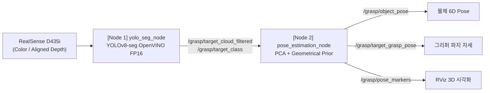

# [기술 보고서] RGB-D 비전 기반 6D Pose 추정 및 2-Finger 적응형 파지(Grasp) 파이프라인 구축

---

## 1. 프로젝트 개요 (Project Overview)

본 프로젝트는 서비스/물류 매니퓰레이션 작업 환경에서 매니퓰레이터(**RB3-730**) 및 2-Finger 적응형 그리퍼(**ROBOTIS RH-P12-RN**)를 활용하여 대상을 정확하게 파지하기 위한 **Eye-in-Hand 비전 파이프라인**을 개발하는 것을 목표로 합니다.

단일 RGB-D 카메라(Intel RealSense D435i)를 사용하여 물체를 감지하고, 물체의 3차원 점군(Point Cloud)과 사전 실측 치수(Geometric Prior)를 결합하여 **무거운 3D 딥러닝 없이도 CPU 실시간(Low-latency)으로 결정론적(Deterministic) 6D Pose 및 목표 파지 포즈(Grasp Pose)**를 추정하는 경량화 파이프라인을 구축하였습니다.

---

## 2. 시스템 구성 환경 (System Architecture)

### 2.1 하드웨어 구성
- **매니퓰레이터**: Rainbow Robotics **RB3-730** (6축 산업용 협동로봇, 가반하중 3kg, 작업반경 730mm)
- **비전 센서**: Intel **RealSense D435i** (Eye-in-Hand 마운트, Color + Aligned Depth)
- **엔드이펙터 그리퍼**: ROBOTIS **RH-P12-RN** (2-Finger 적응형 그리퍼, 최대 스트로크 106mm)
- **임베디드 제어기**: **OpenCR 1.0** (그리퍼 시리얼 통신 및 전류/위치 제어)

### 2.2 소프트웨어 스택
- **운영체제 및 미들웨어**: Ubuntu 22.04 LTS, **ROS 2 Humble**
- **AI 딥러닝 추론 엔진**: Ultralytics **YOLOv8-seg**, Intel **OpenVINO (FP16 최적화, CPU 구동)**
- **언어 및 주요 라이브러리**: Python 3.10, NumPy, OpenCV, `sensor_msgs`, `geometry_msgs`, `visualization_msgs`, `tf2_ros`
- **로봇 제어 인터페이스**: `rbpodo` Python API (추후 연동 예정)

---

## 3. 핵심 노드 설계 및 구현 내용

시스템의 유지보수성과 모듈성을 확보하기 위해 **"인식 노드"**와 **"포즈/파지 추정 노드"**를 명확히 분리하여 설계하였습니다.

### 3.1 `yolo_seg_node` (2D/3D 인식 및 점군 추출)
1. **센서 데이터 동기화**:
   - `message_filters.ApproximateTimeSynchronizer`를 통해 RGB 원본 영상과 Aligned Depth 영상을 밀리초 단위로 동기화 수신.
2. **비동기 추론 & GUI 분리 (Multi-threading)**:
   - ROS 통신 콜백, YOLO 추론 루프(`inference_thread`), OpenCV 렌더링 루프(`display_thread`)를 각각 독립 스레드로 분리.
   - 추론 중에도 카메라 영상 프레임 드롭이나 GUI 프리징이 발생하지 않는 최신 프레임 링 버퍼 패턴 적용.
3. **원본 해상도 다각형 마스크 복원**:
   - YOLO Letterbox(640×640)의 축 왜곡을 방지하기 위해 `masks.xy` 원본 좌표를 추출하여 원본 해상도(640×480) 캔버스에 `cv2.fillPoly`로 정확한 마스크 생성.
4. **3D 점군 역투영 및 전처리**:
   - 카메라 내부 파라미터($f_x, f_y, c_x, c_y$)를 기반으로 픽셀 좌표와 Depth 값을 3D 카메라 좌표계 점군으로 변환 ($X = (u-c_x)Z/f_x, Y = (v-c_y)Z/f_y$).
   - 경계면 배경 노이즈 제거를 위한 마스크 침식(Erosion) 및 유효 거리 필터링(0.1m ~ 1.5m) 적용.
   - `/grasp/target_cloud_filtered` (PointCloud2) 및 `/grasp/target_class` (String) 발행.

---

### 3.2 `pose_estimation_node` (6D Pose & Grasp Pose 산출)
1. **표면 이상치 필터링 (Outlier Rejection)**:
   - 점군 중심점 기준 거리 분포의 상위 5% 백분위수를 이상치로 제거하여 정제된 표면 점군 확보.
2. **PCA(주성분 분석) 기반 3D 주축 추출**:
   - 정제된 점군의 공분산 행렬을 고유값 분해(Eigen Decomposition)하여 3차원 주축($v_0$: 긴 축, $v_1$: 짧은 축, $v_2$: 법선 축) 계산.
   - 카메라 시선 벡터($-Z$)와의 내적을 통해 표면 법선 벡터($v_2$)의 방향성을 항상 카메라 쪽으로 일관되게 정렬.
3. **물체별 맞춤형 기하학 룰 & 실측 치수 매핑**:
   - **4×2 듀플로 블록 ($6.31 \times 3.1 \times 2.31\text{ cm}$)**:
     - **3D 질량 중심 복원**: 표면 중심점에서 법선 방향($-v_2$)으로 실측 중심 오프셋($1.15\text{ cm}$)을 이동하여 보이지 않는 내부 중심점 좌표 복원.
     - **대칭성 해결(뒤집힘 방지)**: 카메라 Y축 벡터와의 내적 검사를 통해 180도 회전 대칭 모호성을 제거하고 항상 일관된 방향 축 유지.
     - **파지 방향 정렬**: RH-P12-RN 그리퍼의 핑거 닫힘 방향($X_g$)을 블록의 짧은 변($v_1, 3.1\text{ cm}$)과 일치시키고, 접근축($Z_g$)을 상단 수직 하강 방향($-v_2$)으로 설정.
   - **망치 ($26.2 \times 8.1\text{ cm}$)**:
     - 주축($v_0$) 상에서 헤드(Head)와 손잡이(Handle) 영역의 너비 방향 점군 분산(Variance) 차이를 분석하여 자동 식별.
     - 헤드가 아닌 손잡이 중심부(손잡이 축의 25% 안쪽)로 파지점을 오프셋하고, 손잡이 원통을 감싸쥘 수 있는 수직 파지 자세 생성.
4. **TF 및 RViz 시각화 발행**:
   - `object_frame`, `grasp_frame` TF 브로드캐스트.
   - 실측 크기 기반의 녹색 3D Bounding Box(`Marker.CUBE`) 및 그리퍼 핑거 닫힘 축을 나타내는 노란색 화살표(`Marker.ARROW`) 발행.

---

## 4. 지금까지의 트러블슈팅 내역 (Troubleshooting Log)

| 번호 | 문제 상황 (Problem) | 근본 원인 (Root Cause) | 해결 방법 및 결과 (Solution & Result) |
| :---: | :--- | :--- | :--- |
| **01** | 마스크가 원본 영상과 어긋나고 세로로 밀리는 현상 | YOLOv8의 `masks.data`가 640×640 Letterbox 비율 기준이어서 640×480으로 단순 리사이즈 시 비율 왜곡 발생 | 원본 해상도로 이미 매핑되어 제공되는 `res.masks.xy` 다각형 좌표를 추출하여 `cv2.fillPoly`로 마스크를 직접 복원하여 해결 |
| **02** | GUI 화면 멈춤 및 카메라 토픽 수신 지연 | ROS 이미지 수신 콜백 내에서 딥러닝 추론과 `cv2.imshow`가 동기식으로 실행되어 블로킹 발생 | 추론 스레드(`inference_thread`)와 디스플레이 스레드(`display_thread`)를 분리하고 최신 프레임 1개만 처리하는 비동기 버퍼 구조 적용 |
| **03** | 불필요한 ROS 토픽 중복 및 직렬화 오버헤드 | 동일한 점군을 4개 토픽(`pc_pub`, `colored_pc_pub`, `raw`, `filtered`)으로 중복 발행하여 CPU 점유율 증가 | RViz 및 하위 노드에서 실제로 사용하는 `target_cloud_raw`, `target_cloud_filtered` 2개로 단일화 및 불필요한 직렬화 코드 제거 |
| **04** | 듀플로 블록 회전 시 180도 축 깜빡임(Flip) | 듀플로 블록의 기하학적 대칭성으로 인해 PCA 계산 시 고유벡터의 부호($\pm v_0$)가 프레임마다 무작위로 반전 | 카메라 optical frame 기준 벡터와의 내적 부호를 검사하여 주축 벡터를 항상 동일한 방향으로 강제 고정하여 뒤집힘 완전 제거 |
| **05** | RViz에서 카메라가 바닥에 붙고 물체가 거꾸로 보이는 문제 | RViz의 Fixed Frame이 `camera_color_optical_frame`으로 되어 있어 카메라 정면(+Z)이 바닥 그리드 아래로 투사됨 | 물체 기준 좌표계(`object_frame`)를 Fixed Frame으로 지정하여 물체가 그리드 바닥 위에 똑바로 서서 렌더링되도록 시각화 개선 |

---

## 5. 앞으로 진행해야 할 과제 (Future Work)

1. **Eye-in-Hand 캘리브레이션 및 TF 변환 (`camera_frame` $\rightarrow$ `base_link`)**
   - 현재 카메라 광학 좌표계 기준인 포즈를 로봇 베이스 기준 좌표계로 변환하는 변환 행렬 연동.
2. **3단계 접근 파지 시퀀스 (Trajectory Waypoints) 생성**
   - 충돌 방지 및 안전한 진입을 위해 `Pre-Grasp` (상공 10cm 진입) $\rightarrow$ `Grasp` (수직 하강 후 파지) $\rightarrow$ `Lift` (상공 10cm 인양)의 단계별 포즈 생성 로직 구현.
3. **RB3-730 로봇 제어기 연동 (`rbpodo` API)**
   - 계산된 베이스 좌표계 Grasp Pose를 `rbpodo.move_l` / `move_j` 명령으로 전달하여 실제 로봇 암 궤적 추종.
4. **OpenCR 기반 그리퍼(RH-P12-RN) 시리얼 통신 연동**
   - 파지 단계에 맞추어 그리퍼 완전 개방(Open) $\rightarrow$ 물체 폭 맞춤형 적응형 파지(Grip) $\rightarrow$ 해제(Release) 시퀀스 통합 제어.
